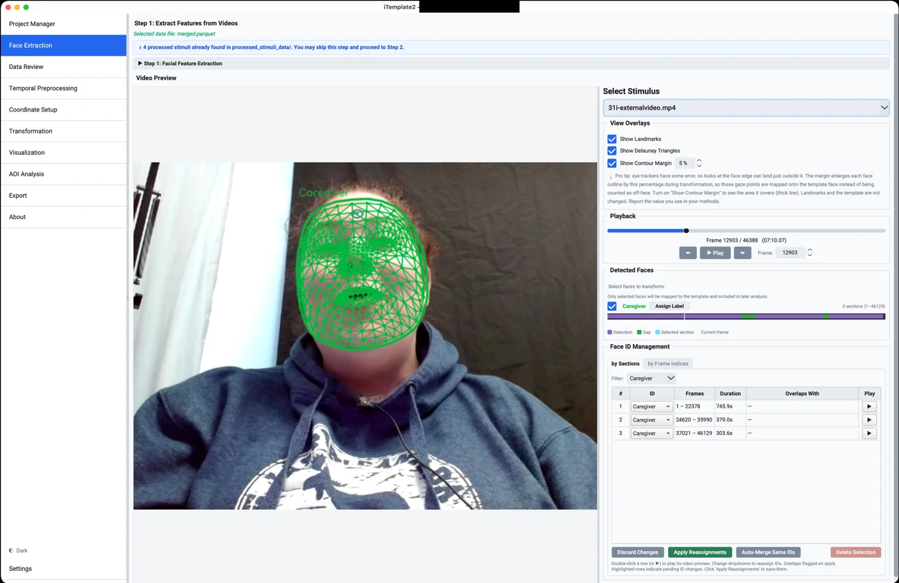
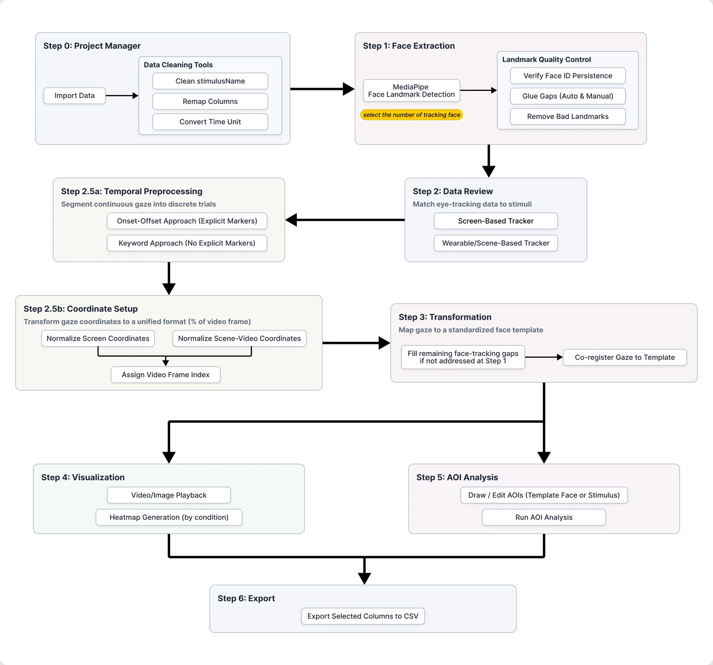

# iTemplate2

**An open-source Python toolbox for automatic eye-movement analysis of dynamic facial stimuli.**

[Project page](https://mcmaster-baby-lab.github.io/iTemplate2-public/) · [Demo video](https://mcmaster-baby-lab.github.io/iTemplate2-public/#demo) · [User guide](docs/user-guide.md) · [Report an issue](https://github.com/McMaster-Baby-Lab/iTemplate2-public/issues) · [License: GPL v3](LICENSE)



iTemplate2 maps eye-tracking gaze data onto a canonical face template. Faces in videos move, turn, change expression and differ in shape from one stimulus to the next, so a gaze point at the same pixel can land on the eye in one frame and the nose in another. iTemplate2 detects the face in every frame, then expresses each gaze sample in the coordinates of a common template face. You define your areas of interest (AOIs) once on that template and apply them to every stimulus, participant and frame, or use the template coordinates for heatmaps and other spatial analyses.

It is a redesign of [iTemplate](https://doi.org/10.3758/s13428-018-1015-x) (Xiao & Lee, 2018), which worked only on static images, needed semi-manual landmark annotation and depended on MATLAB. iTemplate2 is implemented in Python, has a desktop GUI, and works with videos, static images, screen-based eye trackers and wearable eye trackers.

## What's new compared with iTemplate

1. **Dynamic stimuli.** Gaze is transformed frame by frame, with temporal preprocessing for trial segmentation and synchronisation latency, and coordinate normalisation for wearable and scene-camera data.
2. **Automatic, dense landmarks.** [MediaPipe Face Landmarker](https://ai.google.dev/edge/mediapipe/solutions/vision/face_landmarker) finds 478 facial landmarks per face and frame (iTemplate used 39, placed semi-manually) for up to five faces at once, with identity tracking across frames.
3. **Open source, cross-platform.** No MATLAB or other commercial software. A PyQt6 GUI, Apache Parquet storage for large video datasets, and a project settings file for reproducible analyses.
4. **Richer visualisation and analysis.** Gaze playback on the stimulus beside its template-space counterpart, heatmaps with per-participant normalisation, snap-to-landmark AOI drawing, and facial blendshape and head-pose outputs for studying the stimulus face's expression alongside gaze.



## Key features

- **Face extraction** for videos and images, with 478 landmarks, 52 blendshape coefficients and 3D head pose per face
- **Multi-face support:** up to five faces per frame, a Face ID Management workflow to merge, swap, label and remove tracks (for example "Caregiver" and "Infant"), and a review table for gaze samples that fall on overlapping facial meshes
- **Landmark quality control:** gap detection, a configurable maximum fill threshold, a glue tool to interpolate gaps, and re-detection of selected frame ranges
- **Template-based transformation** using a piecewise affine (barycentric) mapping over a Delaunay triangulation of the face, with a face contour margin to tolerate gaze just outside the detected outline
- **Templates:** a built-in average face, or a custom template chosen from a stimulus frame or an uploaded face image
- **Clear gaze classification:** every sample is labelled `on_face`, `off_face` or `unmapped`, with the attended `face_id` for on-face samples
- **Screen-based and wearable eye trackers,** independent of the tracker's make or model, through flexible column mapping and stimulus-name cleaning
- **Temporal preprocessing:** onset/offset trial segmentation and a configurable gaze response lag
- **Visualisation:** synchronised playback, interactive heatmaps with grouping, and video and image export
- **AOI analysis:** polygon AOIs snapped to the 478-point mesh, shareable as JSON, on the template face or in the original stimulus space
- **Reproducible projects:** saved settings, deterministic output names and a timestamped processing log

## How it relates to other methods

iTemplate2 is meant to **complement** existing automatic AOI approaches, not replace them. Several tools already handle moving faces well:

- Keyframe-based dynamic AOIs (for example in Tobii Pro Lab or EyeLink Data Viewer) interpolate 2D position and scale between keyframes you define.
- Landmark-based tools build AOIs directly in the video's own coordinate space from the landmarks detected in each frame, for example [Hessels et al. (2018)](https://doi.org/10.3389/fpsyg.2018.01367) and FaceTrack-AOI ([Zhou et al., 2026](https://doi.org/10.3758/s13428-026-02973-7)).
- Face tracking with a normalised face template has also been used to analyse dyadic interactions, for example by [Haensel et al. (2020)](https://doi.org/10.1038/s41598-020-58802-0).

What the template approach adds is a **common coordinate space in which AOIs are defined once**. That is convenient when you want regions that landmarks do not delineate directly, such as both eyes combined, the centre of the face, the forehead or the cheeks, or when you want to visualise and analyse where gaze falls beyond AOI classification. Pixel-level statistical methods such as [iMap4](https://doi.org/10.3758/s13428-016-0737-x) can also be applied to template-registered data.

Template registration does not remove the decisions in AOI analysis. It moves some of them to the choice of template, the definition of AOIs on that template, and the inspection of facial detections. The validity of the results still depends on your research question, your gaze data quality and the accuracy of the facial mapping.

## Interpret results with care

- **The transformation changes how gaze is represented, not how good it is.** It does not improve gaze accuracy or precision, remove noise or recover missing samples. In wearable and infant recordings, gaze error can be as large as the distance between facial features, so conclusions near AOI boundaries need caution. Check data quality for each recording and see whether results change when AOI boundaries or the contour margin change.
- **Landmarks are estimates.** Detection degrades with occlusion, head rotation beyond roughly ±70°, low resolution and poor lighting, and infant faces are under-represented in the model's training data. Review detections and face IDs before transforming, especially in multi-person scenes.
- **The template shapes the output.** The built-in template is an average of the White female faces in the Chicago Face Database. It places faces of different shapes and sizes in one space, but it does not establish equal detection accuracy across ages or demographic groups.
- **Off-face gaze is not a face location.** Peripheral template coordinates are for display only. Use stimulus-space AOIs for gaze between or beyond faces. These AOIs are currently static, so they do not follow people who move.

More detail is in [Interpreting Transformed Gaze](docs/user-guide.md#interpreting-transformed-gaze).

## Example applications

The paper illustrates the workflow with four developmental eye-tracking projects. These are demonstrations of scope and feasibility, not accuracy benchmarks.

1. **Toddlers watching actresses express emotions** on screen: one set of facial AOIs applied across actresses and across expressions as they change.
2. **Live caregiver–infant interaction** recorded with dual eye tracking: tracking both partners' faces, with face ID checks after occlusion.
3. **Infant responses to infant-directed speech and singing** across 4, 6 and 12 months: 40 videos placed in one coordinate space. AOI classifications differed from four trained manual coders in about 7% of frames, a figure specific to that dataset and not a general measure of accuracy.
4. **Caregiver and infant face looking during free play at home,** recorded with wearable eye trackers: adult and infant faces summarised on the same template.

## Installation

iTemplate2 runs on macOS, Windows and Linux and requires **Python 3.10, 3.11, 3.12 or 3.13**. Python 3.14 is not recommended because some dependencies, especially MediaPipe, may not yet provide compatible wheels on every platform.

### 1. Get the code

```bash
git clone https://github.com/McMaster-Baby-Lab/iTemplate2-public.git
cd iTemplate2-public
```

### 2. Create an environment

**Option A (recommended): venv + pip**

```bash
python -m venv .venv
source .venv/bin/activate        # On Windows: .venv\Scripts\activate
python -m pip install --upgrade pip
python -m pip install -r requirements.txt
```

**Option B: conda**

```bash
conda env create -f environment.yml
conda activate iTemplate2
```

> **Linux:** PyQt6 needs the `xcb-util-cursor` package. Install it first, for example `sudo apt install xcb-util-cursor` (Debian/Ubuntu) or `sudo dnf install xcb-util-cursor` (Fedora/RHEL).

The MediaPipe face model (`face_landmarker.task`) and the average face template (`average_face_data.h5`) are included in the repository root.

### 3. Launch the app

```bash
python start_gui.py
```

A sidebar on the left lists every processing step, with **Settings** at the bottom.

## Getting started

1. Read [Before You Begin: Know Your Data](docs/user-guide.md#before-you-begin-know-your-data) to check that you know your dataset's columns, timing and stimulus names.
2. In **Step 0**, create a project and import your gaze data.
3. Follow Steps 1 to 6 in the sidebar: face extraction, data review, temporal preprocessing and coordinate setup, transformation, visualisation, AOI analysis and export.

The [user guide](docs/user-guide.md) covers every step, the parameter reference, the required data columns and troubleshooting.

## Documentation

| Document | Contents |
|---|---|
| [User guide](docs/user-guide.md) | Step-by-step GUI workflow, parameters, data requirements, interpreting results, logging, troubleshooting |
| [Gap management](docs/gap_management.md) | Understanding landmark gaps, choosing a threshold, using the glue tool |
| [Architecture](docs/architecture.md) | Code layout and the `core/` modules for developers |

The software is also archived on the [Open Science Framework](https://osf.io/54v9e/), the project cited in the paper.

## Citation

If you use iTemplate2 in your research, please cite:

> Xiao, N. G., Román-Caballero, R., Fang, W., Ripley, S., Han, D., & Trainor, L. J. (in press). iTemplate2: An open-source Python toolbox for automatic eye-movement analysis of dynamic facial stimuli.

<!-- TODO: add journal, volume, year and DOI once available (also in CITATION.cff) -->

GitHub's **Cite this repository** button, in the sidebar, uses [`CITATION.cff`](CITATION.cff).

The original method is described in:

> Xiao, N. G., & Lee, K. (2018). iTemplate: A template-based eye movement data analysis approach. *Behavior Research Methods, 50*(6), 2388–2398. https://doi.org/10.3758/s13428-018-1015-x

## Authors

Developed by Dr. Gabriel (Naiqi) Xiao with contributions from Dr. Rafael Román-Caballero, Dr. Wei Fang, Sara Ripley, Dr. Danyang Han and Dr. Laurel J. Trainor, at the McMaster Baby Lab, McMaster University. Contributing authors are also affiliated with the University of Granada (Spain) and Zhejiang University (China).

## Funding and acknowledgements

This work was supported by the following. Initials show the grant holder.

- Social Sciences and Humanities Research Council of Canada (SSHRC): grants 435-2022-0838 (N.G.X.) and 435-2020-0442 (L.J.T.)
- Natural Sciences and Engineering Research Council of Canada (NSERC): grants RGPIN-2020-07129 (N.G.X.) and RGPIN-2019-05416 (L.J.T.)
- Canadian Institute for Advanced Research (CIFAR): awarded to L.J.T.
- National Natural Science Foundation of China: grant 32400886 (D.H.)
- European Union's Horizon 2020 research and innovation programme, Marie Skłodowska-Curie Actions Global Postdoctoral Fellowship: project 101149355 (R.R.-C.)

We thank the research students and volunteers who helped test the software and create figures: Lorena Morcone, Emma Whittier, Grace Kakarelis, Muhan (Joanne) Liu, Maya Krieger, Selena Li, Emma Resendes, Meg Lyu, Maya Mammon, Olive Rinaldi, Leqi Feng and Fei Yang.

## Support

Questions, bug reports and feature requests are welcome on the [issue tracker](https://github.com/McMaster-Baby-Lab/iTemplate2-public/issues). If something goes wrong in the app, `processing_log.txt` in your project folder records every step, including errors.

## License

iTemplate2 is free software, released under the [GNU General Public License v3.0 or later](LICENSE) (`GPL-3.0-or-later`). You may use, study, share and modify it for any purpose, including research and commercial work.

- **Your data and results are not affected.** Analysing data with iTemplate2 does not make your data, figures or outputs subject to the GPL.
- **If you distribute it,** including a modified version or software that incorporates iTemplate2, you must release that software under the same license and make its source code available.
- **No warranty.** iTemplate2 comes with ABSOLUTELY NO WARRANTY, as set out in the license.

The graphical interface uses [PyQt6](https://www.riverbankcomputing.com/software/pyqt/), which is available under the GPL v3, and the other dependencies use licenses that are compatible with it.

Copyright © 2026 the iTemplate2 authors.
