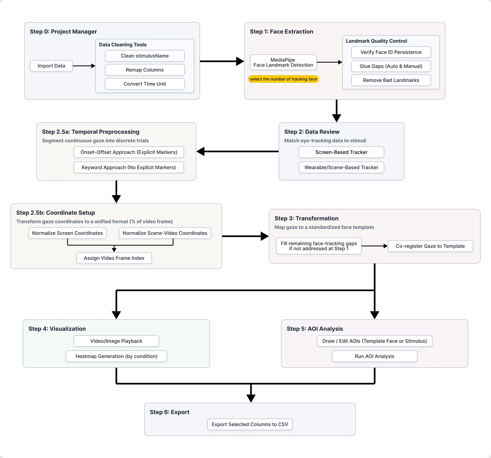
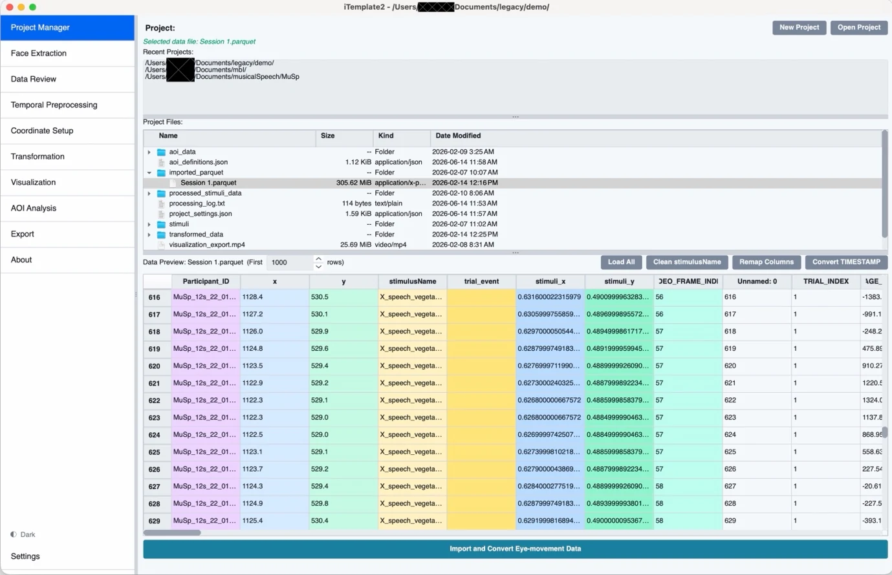
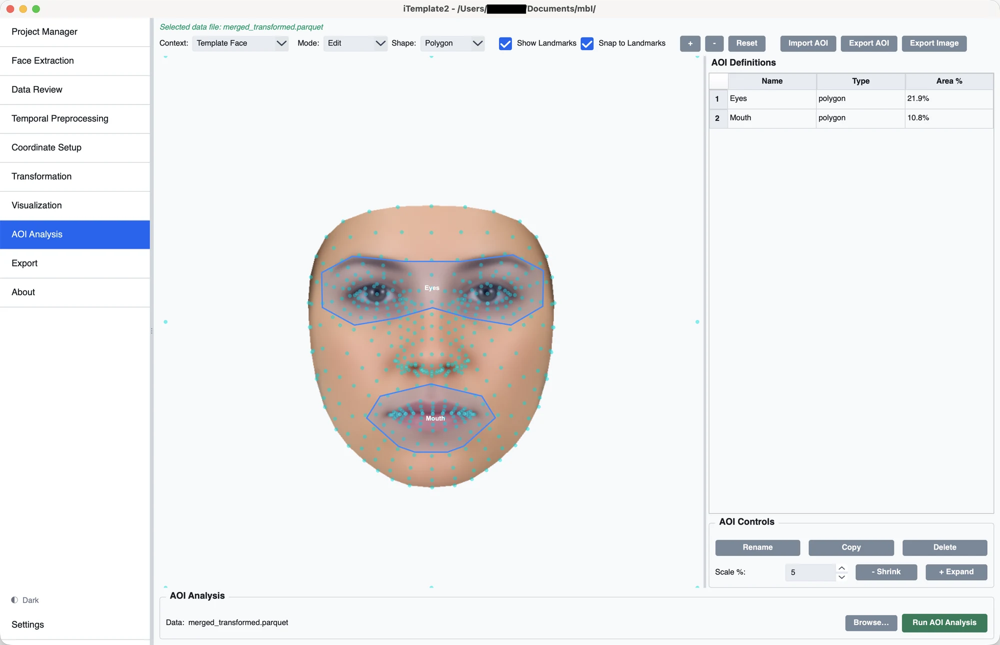

# iTemplate2 User Guide

A step-by-step guide to the iTemplate2 GUI, its parameters, and the data it expects. New to the app? Start with [Before You Begin](#before-you-begin-know-your-data), then follow Steps 0–6 in order. For installation, see the [README](../README.md).

---

## Before You Begin: Know Your Data

Before you start importing and processing data in iTemplate2, it is **critical that you understand the structure of your own eye-tracking dataset**. Because iTemplate2 is designed to be highly flexible and agnostic to the specific make/model of your eye-tracker (e.g., Tobii, SR Research, Pupil Labs, custom cameras), you will need to map your data's columns and logic into the pipeline.

**Make sure you can answer these questions about your data:**

1. **How is your data organized?** 
   - Is all participant data combined into one massive file, or does every participant have their own file? (This determines your choice in [Step 0](#step-0-project-manager)).
2. **What are your coordinate columns?**
   - Which columns represent the `x` and `y` gaze (or fixation) coordinates? You will need to map these during Import.
3. **What is your temporal column?**
   - Which column represents time (e.g. `TIMESTAMP`, `RecordingTime`)? Is it in milliseconds, microseconds, or seconds? (This is needed for [Temporal Preprocessing](#step-25a-temporal-preprocessing)).
4. **How are trials defined in your data?**
   - Does your eye-tracker output explicit `STIM_ON` / `STIM_OFF` markers in a message column?
   - OR do you need to look at a `Media_Name` or `Trial_Type` column that changes value when a stimulus plays? (This determines your approach in [Temporal Preprocessing](#step-25a-temporal-preprocessing)).
5. **Where are the stimulus names?**
   - Which column records the name of the image/video the participant was looking at? The values in this column **must perfectly match** the filenames of the videos/images you put in the `stimuli/` folder. (Though you can use the "Clean stimulusName" tool in [Step 0](#step-0-project-manager) to trim paths or extensions if needed).
6. **Are you using a Screen-based or Wearable eye-tracker?**
   - Wearable data usually requires mapping the data file to the specific scene video worn by that participant. Screen-based data usually maps gaze onto a stationary monitor. (This affects choices in [Step 2](#step-2-data-review) and [Step 2.5b](#step-25b-coordinate-setup)).

If you aren't sure about the answers, open your raw `.csv` or `.txt` data file in Excel or a text editor and explore it first!

---

## Project Folder Structure

When you create or open a project, iTemplate2 expects (and auto-creates) the following layout:

```
my_project/
├── stimuli/                     # Original stimulus files (videos/images)
├── processed_stimuli_data/      # Landmark Parquet files from Face Extraction
├── imported_parquet/             # Converted gaze data in Parquet format
├── transformed_data/             # Transformation output
│   └── <name>__<template>__<run>_transformed.parquet
├── results/                      # AOI analysis output
│   └── <name>_AOI.parquet
├── project_settings.json         # Persisted parameter values
└── processing_log.txt            # Timestamped processing log (auto-generated)
```

---

## Data File Naming

iTemplate2 uses **fixed, deterministic output filenames**. Re-running a processing step overwrites the previous output rather than creating timestamped copies.

| Step | Input | Output | Location |
|---|---|---|---|
| **Import** | `raw_data.csv` | `raw_data.parquet` | `imported_parquet/` |
| **Transformation** | `raw_data.parquet` | `raw_data__<template>__<run>_transformed.parquet` | `transformed_data/` |
| **AOI Analysis** | `raw_data__<template>__<run>_transformed.parquet` | `raw_data__<template>__<run>_transformed_AOI.parquet` | same directory |

**Suffix deduplication** — If the input file already contains the output suffix (e.g. re-processing `data_transformed.parquet`), the suffix is stripped before being re-appended, preventing chains like `data_transformed_transformed.parquet` or `data_AOI_AOI.parquet`.

---

## GUI Workflow — Step by Step

### UI Tour at a Glance

The sidebar on the left is the main navigation. Each step in the pipeline is a separate page, so beginners can follow the workflow top to bottom without hunting for hidden menus.



This flowchart shows the recommended path through the app:

- `Step 0` prepares the project and imports data.
- `Step 1` extracts and cleans face landmarks from stimulus videos or images.
- `Step 2` matches gaze files to the correct stimuli.
- `Step 2.5a` and `Step 2.5b` prepare timing and coordinate data.
- `Step 3` maps gaze onto the normalized face template.
- `Step 4` visualizes gaze over the stimulus and as heatmaps.
- `Step 5` defines AOIs and runs AOI analysis.
- `Step 6` exports selected columns to CSV.

### Step 0: Project Manager

The landing page for managing projects.



Use the top-right buttons to start or open a project:

- **New Project** creates the folder structure used by iTemplate2.
- **Open Project** loads an existing project and its settings.

The file browser in the middle shows the project contents and lets you inspect the files that will move through the pipeline.

| Action | Description |
|---|---|
| **New Project** | Creates a new folder with standard sub-directories (`stimuli/`, `processed_stimuli_data/`, `imported_parquet/`). |
| **Open Project** | Selects an existing project folder. |
| **Recent Projects** | Click any recently opened project to switch to it. |
| **File Browser** | Tree view of project files. Click a `.parquet` or `.csv` file to preview its contents. Right-click to delete files. |
| **Import and Convert Eye-movement Data** | Converts raw CSV/TXT gaze data files into Parquet format for efficient downstream processing. |

**How to organize your data for import:**

- **Select Files (Convert Individually):** Use this if your data is already merged into a single file, **or** if you need to process individual files separately.  
  *Crucial for Wearable and Screen-based Eye-tracking Data:* Wearable eye-trackers often record a generic stimulus name (e.g., "external video") for every participant. If you merge these files now, you won't know which video belongs to whom! Import them individually here, keep them separate, and use the **Data Review** step later to map them to their unique videos and seamlessly merge them.
```text
      Data:
      ├── Participant_1_gaze.csv        →   Select Files
      └── Participant_2_gaze.csv        →   (Keeps them separate)
```

- **Select Directory (Merge contents):** Use this if each participant has their own file, but their internal stimulus names are already correct and distinguishable (e.g. screen-based task), so you want iTemplate2 to automatically merge them into one unified dataset immediately.
```text
      Folder contents:
      ├── sub01_data.csv                
      ├── sub02_data.csv                →   Select Folder
      └── sub03_data.csv                →   (Merges into one file)
```

**During import you will be prompted to:**
- **Map columns** — If your data doesn't have the exact required column names (see [Required Data Columns](#required-data-columns)), you can map your columns to the expected names.
- **Clean `stimulusName`** — Optionally strip path prefixes (e.g. `expt/face.png` → `face.png`) and/or file extensions (e.g. `face.png` → `face`).

**Post-import utilities** (available when a `.parquet` file is selected):
- **Clean stimulusName** — Remove/add prefixes and suffixes from the `stimulusName` column.
- **Remap Columns** — Rename columns in an existing Parquet file.
- **Double-click a column header** — Rename that single column directly.

---

### Step 1: Face Extraction

Extracts facial landmarks from your stimulus videos or images using MediaPipe's Face Landmarker.

This page is where you prepare and inspect stimulus landmarks:

- The **Select Video** dropdown switches between stimuli in the `stimuli/` folder.
- **Show Landmarks** and **Show Delaunay Triangles** toggle the preview overlays on the video/image canvas.
- The playback controls below the preview let you scrub through frames and verify detection quality.
- The **Face ID Management** panel is where you rename faces, merge IDs, or discard incorrect detections.
- The **Landmark Quality Control** tools let you remove bad frames, inspect gaps between detection sections, and glue short gaps back together when the face is still present.

| Control | Description |
|---|---|
| **Add Stimuli** | Select stimulus files (`.mp4`, `.avi`, `.mov`, `.webm`, `.jpg`, `.jpeg`, `.png`, `.bmp`). |
| **Clear** | Remove all files from the list. |
| **Parallel Workers** | Number of files to process simultaneously (see [Parameter Reference](#parameter-reference)). |
| **Start Extraction** | Runs landmark extraction. A progress bar is displayed directly on the button, showing the percentage of files completed. Output is saved to `processed_stimuli_data/` primarily as Parquet files (CSV optional). |

> **Notice:** If processed landmarks already exist in `processed_stimuli_data/`, a blue banner at the top of the page will inform you. You can skip this step if landmarks are already available.

#### Video / Image Preview

After extraction (or when processed landmarks already exist), the built-in preview lets you inspect results frame-by-frame. Both video files and images from the `stimuli/` folder are listed in the selector. For images, the slider and playback controls are automatically disabled (single frame).

| Control | Description |
|---|---|
| **Stimulus selector** | Dropdown populated from the `stimuli/` folder (videos and images). Selecting an item loads it for preview. |
| **Frame display** | Shows the current video frame with optional overlays. |
| **Progress slider** | Draggable slider to scrub to any frame. |
| **▶ Play / ⏹ Stop** | Start or stop playback at the video's native frame rate. |
| **⏪ / ⏩** | Step one frame backward or forward. |

#### Landmark & Delaunay Overlay

When processed landmark data is available for the selected video, these overlay options become active:

| Control | Description |
|---|---|
| **Show Landmarks** | Draws landmark points on each frame using coordinates from the generated `_landmarks.parquet`. |
| **Show Delaunay Triangles** | Draws the Delaunay triangulation mesh connecting the landmarks. |

If a frame has no landmark data (e.g. the face was not detected, or the landmarks were manually removed), a "No landmarks for this frame" notification is displayed on the video frame.


#### Landmark Quality Control & Gap Management

When processing video stimuli, face landmark extraction may miss frames because of head movement, occlusion, or lighting. These missing stretches create *gaps* between contiguous detection sections, and the two related controls below help you manage them consistently:

| Control | Description |
|---|---|
| **🗑 Remove Landmark** | Deletes the landmark data for the current frame from the `_landmarks.parquet` file. Use this to manually remove incorrectly detected landmarks. |
| **Gap selector** | When a face has multiple detection sections, a dropdown lists each gap between sections with its frame count and duration in seconds. |
| **Glue Gap** | Bridges the selected gap by linearly interpolating all 478 landmark coordinates between the boundary frames. New rows are written permanently to the `_landmarks.parquet` file. Use this when a gap was caused by a brief tracking loss but the face was actually present. |

These controls feed into the broader gap-handling behavior used later in the pipeline:

1. **Max Gap Fill Threshold** (Step 3 — Transformation): Automatically fills gaps up to a configurable size (default: 2.0 seconds). Larger gaps are left as NaN. This prevents silently incorrect coordinate remapping for large gaps where the face was not present.
2. **Manual Gap Glue** (Step 1 — Face Extraction): Bridges a specific gap by linearly interpolating all 478 landmark coordinates between the boundary frames. New rows are written permanently to the `.parquet` landmark file. Use this when a gap was caused by a brief tracking loss but the face was actually present.
3. **Automatic interpolation after removal**: Frames with removed landmarks are automatically interpolated during the **Transformation** step (Step 3), so removing bad detections improves overall quality.

See [Gap Management](gap_management.md) for a detailed guide on understanding gaps, choosing a threshold, and using the glue tool.


#### Face Selection & Management

If multiple faces are detected in a video, iTemplate2 provides tools to manage them before transformation:

- **Face Selector**: When viewing the preview, use the face selector dropdown to switch between detected faces. The overlay will update to show the landmarks for the selected face.
- **Face Labels**: You can rename detected faces (e.g., "Face 0" → "Target Face") to make them easier to identify during the transformation and analysis stages.
- **Manual Removal**: Use the **Remove Landmark** tool to delete specific frames from a face's landmark data if it was incorrectly detected.

---

### Step 2: Data Review

Matches your gaze data against processed stimuli to verify alignment before transformation. The page has two tabs:

#### Tab: Screen-based Eye Tracker

Matches `stimulusName` values in gaze data against processed landmark files in `processed_stimuli_data/`.

| Column | Meaning |
|---|---|
| **stimulusName (in data)** | Unique stimulus names found in your gaze data. |
| **Matched Processed File** | The corresponding landmark file found in `processed_stimuli_data/`. |
| **Status** | ✓ Matched or ✗ Missing. |

If stimuli are missing, go back to **Step 1** to process them, or use the **Clean stimulusName** tool in the Project Manager to fix naming mismatches.

#### Tab: Wearable / Scene-based Eye Tracker

For wearable eye trackers where each participant has an individual data file and a corresponding scene video. Matches data files to videos and provides tools to prepare them for the pipeline.

##### Matching Strategies

Choose from four methods to pair data files with scene videos:

| Strategy | When to use | Example |
|----------|-------------|--------|
| **Exact basename** | Filenames are identical (minus extension) | `sub01.parquet` ↔ `sub01.mp4` |
| **First N characters** | Filenames share a common prefix | `P01_session1.parquet` ↔ `P01_recording.mp4` (N=3) |
| **Contains** | One filename contains the other (case-insensitive) | `experiment_sub01_data.parquet` ↔ `sub01.mp4` |
| **Manual** | No naming convention; pick from a dropdown per file | Any arbitrary naming |

##### Example Scenarios

**Scenario 1 — Clean naming convention:**
```
      Data:    sub01.parquet   sub02.parquet   sub03.parquet
      Videos:  sub01.mp4       sub02.mp4       sub03.mp4
      → Use "Exact basename"
```

**Scenario 2 — Shared prefix with different suffixes:**
```
      Data:    P01_eyetrack.parquet   P02_eyetrack.parquet
      Videos:  P01_scene.mp4          P02_scene.mp4
      → Use "First N characters" with N = 3
```

**Scenario 3 — Video name embedded in data filename:**
```
      Data:    2024_study_alice_gaze.parquet   2024_study_bob_gaze.parquet
      Videos:  alice.mp4                        bob.mp4
      → Use "Contains" ("alice" is found inside "2024_study_alice_gaze")
```

**Scenario 4 — Completely different naming:**
```
      Data:    recording_001.parquet   recording_002.parquet
      Videos:  monday_morning.mp4      tuesday_afternoon.mp4
      → Use "Manual" and select each video from the dropdown
```

##### Actions

| Button | Description |
|---|---|
| **Set stimulusName from Video** | Writes the matched video's basename into the `stimulusName` column of each data file. |
| **Merge into Single File** | Concatenates all data files into `imported_parquet/merged.parquet`, adding a `Participant_ID` column from each file's basename. Sets the merged file as the global selection. |

---

### Step 2.5a: Temporal Preprocessing

Segments continuous gaze data into discrete trials using onset/offset markers from your data. This step is primarily important for **video stimuli**, because the pipeline needs trial boundaries to assign specific frame numbers (`VIDEO_FRAME_INDEX`) to each gaze sample. For studies using **images as stimuli**, this step can be skipped — the transformation can simply rely on `stimulusName` to match gaze data to the correct landmark file.

#### Gaze Data File

| Parameter | Description |
|---|---|
| **Gaze Data File** | The imported Parquet file containing your gaze data. Auto-populated from the project. |

#### Temporal Column Setup

| Parameter | Description |
|---|---|
| **Primary Temporal Column** | The main column representing temporal order in your data (e.g., `TIMESTAMP` in ms). |
| **Secondary Temporal Column** | An optional second column for further ordering (e.g., `Fixation_Index` when using `Trial_Index` as primary). |
| **Sort Data** | Sorts the data by `Participant_ID` + the selected temporal columns and creates a `_temporal_order` column for downstream use. A progress bar is shown on the button during processing. |

#### Identify Video Onset and Offset

Two approaches are available, presented as tabs. Choose the one that matches your data format.

##### Tab: Onset-Offset Approach

Use this approach when your eye-tracking data contains **explicit event markers** that signal the start and end of each trial (e.g., messages logged by the eye-tracker software like `STIM_ON` / `STIM_OFF`).

**Video Onset** — defines when each video playback begins. Select the column in your gaze data that contains event markers (e.g., `MESSAGE`), then pick the specific marker value(s) that signal the start of stimulus presentation. Each matching row is tagged as `STIM_ONSET` in the output.

| Parameter | Description |
|---|---|
| **Marker column** | The column containing onset event markers. |
| **Onset marker values** | The specific values that signal trial start (multi-select). |
| **Onset offset (ms)** | Milliseconds between the onset marker and actual video playback start. When > 0, `STIM_ONSET` is placed at the first gaze sample whose timestamp ≥ marker timestamp + offset, rather than on the marker row itself. Use `0` (default) if there is no delay. |

**Video Offset** — defines when each video playback ends. Two modes are available:

- **Use marker** — select a column and marker value(s) that signal the end of stimulus presentation (e.g., a `STIM_OFF` event). Each matching row is tagged as `STIM_OFFSET`.
- **Use duration from onset** — specify a fixed trial length (e.g., 5 s). The offset is placed at the first gaze sample whose timestamp exceeds onset + duration. Useful when your data does not contain explicit offset markers.

| Parameter | Description |
|---|---|
| **Offset mode** | Toggle between **Marker** and **Duration** modes. |
| **Marker column** | *(Marker mode)* The column containing offset markers. |
| **Offset marker values** | *(Marker mode)* The specific values that signal trial end. |
| **Duration** | *(Duration mode)* The fixed trial length. |
| **Duration unit** | *(Duration mode)* `seconds (s)` or `milliseconds (ms)`. Must match the unit of your TIMESTAMP column. |

##### Example Scenario — Explicit Event Markers

If your eye-tracker logs include explicit string messages like `STIM_ON` when the video begins and `STIM_OFF` when it ends.

**Your Data:**
```text
      TIMESTAMP | x    | y    | MESSAGE    | (other columns)
      ------------------------------------------------------
      1000      | NaN  | NaN  | STIM_ON    | ← Video Onset Marker
      1016      | 450  | 500  | NaN        |
      ...       | ...  | ...  | NaN        |
      5000      | NaN  | NaN  | STIM_OFF   | ← Video Offset Marker
```

**Settings in GUI:**
- **Onset marker column:** `MESSAGE`
- **Onset marker values:** `STIM_ON`
- **Offset mode:** `Marker`
- **Offset marker column:** `MESSAGE`
- **Offset marker values:** `STIM_OFF`

Clicking **Apply Video Markers** processes the data and writes `STIM_ONSET` / `STIM_OFFSET` tags into a `trial_event` column on the corresponding marker rows.

##### Tab: Keyword Approach

Use this approach when your data does **not** contain discrete onset/offset event markers, but instead has a column whose values indicate whether a row belongs to a stimulus presentation (e.g., a `MEDIA_NAME` column that contains the video filename during playback, or a `trial_type` column with values like `"video"` or `"fixation_cross"`).

Filter rows by column values using **include** and/or **exclude** criteria (each can reference a different column). The first row of each contiguous block of matching rows is tagged as `STIM_ONSET`, and a new onset is also placed whenever the `stimulusName` changes within a matched region.

| Parameter | Description |
|---|---|
| **Include column** | Column to match for inclusion. Leave at `-- None --` to skip. |
| **Include values** | Rows where the column equals any of these values are kept (multi-select). Select `<empty>` to match blank/NaN cells. |
| **Exclude column** | Column to match for exclusion (can differ from the include column). Leave at `-- None --` to skip. |
| **Exclude values** | Rows where the column equals any of these values are removed (multi-select). Select `<empty>` to match blank/NaN cells. |

When both include and exclude criteria are active, they are AND-combined: a row must match the include filter **and** not match the exclude filter.

##### Example Scenario — Extracting Trials without Explicit Markers

Many datasets do not contain explicit `STIM_ON` markers, but instead record the active stimulus in one column, and maybe other state information in another column. The Keyword Approach handles these cases.

**Scenario A: Single Column Filtering**
Your data changes a column value when a trial starts.

**Your Data:**
```text
      TIMESTAMP | x    | y    | Media_Name       |
      --------------------------------------------
      ...       | ...  | ...  | instructions.jpg |
      1000      | 450  | 500  | face_video_1.mp4 | ← Include value matches (New trial starts)
      1016      | 452  | 498  | face_video_1.mp4 | 
      ...       | ...  | ...  | face_video_1.mp4 |
      5000      | 460  | 510  | fixation.jpg     | ← Include value no longer matches (Trial ends)
      5500      | 440  | 520  | face_video_2.mp4 | ← Include value matches (New trial starts)
```

**Settings in GUI:**
- **Include column:** `Media_Name`
- **Include values:** `face_video_1.mp4`, `face_video_2.mp4`, etc.

**Scenario B: Multi-Column Filtering**
You want to identify the exact start of playback. Often, the eye tracker records the filename (`Media_Name`), but the video might not start playing immediately until the `Frame_Index` begins incrementing.

**Your Data:**
```text
      TIMESTAMP | Media_Name       | Frame_Index |
      --------------------------------------------
      1000      | face_video_1.mp4 | NaN         | ← Video loaded, but not playing 
      1016      | face_video_1.mp4 | NaN         | 
      1032      | face_video_1.mp4 | 0           | ← Both conditions met: Playback begins
      1048      | face_video_1.mp4 | 1           | 
```

**Settings in GUI:**
- **Include column:** `Media_Name`
- **Include values:** `face_video_1.mp4`, `face_video_2.mp4`, etc.
- **Exclude column:** `Frame_Index`
- **Exclude values:** `<empty>`

*How this works:* By selecting `<empty>` for the exclude column, any row where `Frame_Index` is NaN/blank is excluded. The pipeline searches for the first row that matches the include criteria *and* doesn't match the exclude criteria (i.e., the first row where `Media_Name` is the video AND `Frame_Index` is not empty).

Clicking **Apply Keyword Filter** parses these continuous columns block-by-block, finds where the blocks start based on your criteria, and writes `STIM_ONSET` tags into the `trial_event` column for you.

> **Notice:** If `trial_event` data already exists in your gaze data, a blue banner at the top informs you that you may skip this step.

---

### Step 2.5b: Coordinate Setup

Configures coordinate normalisation and video frame index assignment. The page has two tabs. When a project is open, the `stimuli/` folder is automatically scanned on page load.

#### Tab: Screen-based Eye Tracker

For traditional screen-based setups where gaze coordinates reference the monitor.

##### Screen Configuration

| Parameter | Description |
|---|---|
| **Screen Width / Height (px)** | The display resolution used during data collection. |
| **Stimuli centred on screen** | When checked, gaze coordinates are adjusted so (0, 0) is the top-left of the stimulus. |
| **Centre X / Y (px)** | *(Unchecked only)* Custom stimulus centre position. |

##### Normalisation

Converts raw pixel gaze coordinates (`x`, `y`) into normalised stimulus-relative coordinates (`stimuli_x`, `stimuli_y`) as proportions of stimulus width/height.

#### Tab: Wearable Eye Tracker

For wearable eye trackers where gaze coordinates are already projected onto scene video frames (no monitor involved).

##### Scene Video Filter

| Parameter | Description |
|---|---|
| **Filter column** | Column that identifies rows belonging to the scene video recording (e.g., `trial_event`, `MEDIA_NAME`). |
| **Keyword value** | Only rows where the filter column equals this keyword will be processed. |

##### Normalisation

Simply divides gaze coordinates by video dimensions: `stimuli_x = x / video_width`, `stimuli_y = y / video_height`. No screen parameters needed.

#### Video Frame Index Assignment (shared)

| Parameter | Description |
|---|---|
| **Frame Rate (FPS)** | Frames per second of your stimulus videos (auto-detected from stimuli scan). |
| **Gaze Response Lag (ms)** | Lag (in ms) between a visual event in the video and the observer's overt eye-movement response. Shifts frame indices backward so each gaze sample maps to the frame that caused the response. |
| **Assign Frame Index** | Computes and writes a `VIDEO_FRAME_INDEX` column. In screen-based mode, groups by `stimulusName` with onset markers. In wearable mode, groups by `Participant_ID` using the first timestamp as start. |

---

### Step 3: Transformation

Runs the core iTemplate2 transformation pipeline — co-registering gaze coordinates from stimulus space into the normalised face template space.

| Parameter | Description |
|---|---|
| **Stimuli Type** | Whether stimuli are **Video** or **Image**. Defaults to **Video**; your selection is saved and persists across page navigation. |
| **Gaze Data File** | Path to the processed gaze Parquet file (auto-populated). |
| **Stimuli Folder** | Path to the folder containing original stimuli (auto-populated to `stimuli/`). |
| **Landmark Folder** | Path to the folder containing processed landmark data (auto-populated to `processed_stimuli_data/`). |
| **Parallel Workers** | Number of Dask workers for parallel computation (see [Parameter Reference](#parameter-reference)). |
| **Max Gap Fill (seconds)** | Maximum gap size (in seconds) that is automatically filled during Stage 1 (Frame Index Remapping). Gaps larger than this threshold are skipped, and gaze rows in those frames remain as NaN. Set to 60.0 to disable the threshold (fill all gaps). Default: 2.0 seconds. See [Gap Management](gap_management.md) for details. |
| **Run Transformation Pipeline** | Starts the transformation. A progress bar is displayed on the button, showing the percentage of stimuli processed. |

**Output** (saved to `transformed_data/`):
- `<name>__<template>__<run>_transformed.parquet` — The full gaze dataset with added `transformed_x`, `transformed_y`, `face_id`, `face_label`, and `gaze_region` columns. Each run creates a new file, preserving earlier results. Embedded Parquet metadata and a JSON manifest identify its template, prepared input, landmarks, and processing settings.

Transformation first checks facial triangles for every selected face. A sample on Face 2 is transformed using Face 2's landmarks even if it lies inside Face 1's peripheral mesh. Once a facial assignment is made, other faces cannot overwrite it. If facial regions overlap, the first face in the processing order takes precedence; the selection dialog returns IDs in ascending order.

Only samples outside all selected facial regions are mapped through peripheral triangles for display. These samples have `gaze_region = off_face`, a missing `face_id`, and `face_label = Off-face`. Their peripheral template coordinates do not represent facial anatomy and are excluded from template AOI classification. The first available face in processing order supplies the peripheral display mapping. If no usable mapping exists (for example, missing landmarks or invalid gaze), the sample remains `unmapped`. Original gaze coordinates are retained. Classification is relative to the selected faces; an unselected face is not a candidate for facial assignment.

---

### Custom template faces

The **Template Face** panel in Transformation supports three actions:

- **Choose from Stimulus** opens Face Extraction. Navigate to a frame, check exactly one detected face, and click **Use Selected Face as Template**. The existing landmark record is reused; no new detection is run. Inspect the preview and choose **Use This Template**. The application returns to Transformation.
- **Upload Face Image** detects landmarks using MediaPipe in an isolated background process. Select a face in the preview if several are detected, then apply it. Detector failures are reported without terminating the application.
- **Reset to Default** restores the supplied Chicago Face Database average face.

A selected face is cropped with a margin without changing its aspect ratio. Choose a clear, frontal face: incompatible or collapsed mesh triangles are rejected. The default triangle connectivity is retained, so choosing a target does not change source-face membership or overlap precedence.

Applying or resetting a template automatically reruns transformation with the current prepared gaze input and processing settings. If inputs are missing, the selection remains pending. Loading a project restores the selection without automatically starting processing. Results from a failed run do not replace the last successful dataset.

Project templates are stored in `templates/<template_id>/`, including the image, landmarks, mesh, original snapshot, and provenance. Versioned transformed outputs include stable `gaze_sample_id` values and a `template_id`. Visualization, AOI Analysis, and exports use the template associated with the selected dataset, even when Processing currently requests another template. CSV exports include a companion `.manifest.json`; retain it with the CSV. Custom template assets must accompany a shared project.

Facial AOI definitions are stored separately for each template. Define new AOIs for a new template; resetting restores the previous default-template definitions. Stimulus AOIs remain tied to their stimuli. Existing AOI results are not updated automatically; rerun AOI Analysis for the new transformed dataset.

Saved manual overlap assignments are stored under `review_decisions/`. When source data, extracted landmarks, face selection, stimulus type, and gap settings are unchanged, these decisions are replayed with coordinates recomputed for the new template. Changed context requires fresh review. Older datasets without sample identity and provenance remain viewable with the default template, but cannot automatically transfer review decisions.

A study-specific template changes the reference geometry; it does not improve the quality of recorded gaze data or establish demographic equivalence.

### Step 4: Visualization

Provides interactive playback of stimulus videos/images overlaid with gaze data, plus heatmap distribution plots.

This page is split into two working areas:

- The **Playback Panel** on the top left shows the original stimulus and the overlaid gaze points.
- The **Heatmap Panel** on the lower half generates distribution plots from the transformed gaze data.
- Use **Stimulus selector**, **Play / Pause / Step**, and the **Frame slider** to inspect the data frame by frame.
- Use **Bins**, **Sigma**, and **Group by columns** to control how the heatmap is aggregated.
- **Normalise by participant** keeps one participant from dominating the heatmap when sample counts differ.
- **Export Video** saves the gaze overlay as a movie, and **Export Image** saves the heatmap figure.

#### Playback Panel (left)

| Control | Description |
|---|---|
| **Stimulus selector** | Dropdown to pick which stimulus to visualise. |
| **Play / Pause / Step** | Standard video playback controls. |
| **Frame slider** | Scrub through video frames. |
| **Export Video** | Export the gaze-overlaid video as an MP4 file. |

#### Heatmap Panel (right)

| Parameter | Description |
|---|---|
| **Bins** | Number of histogram bins for the 2D heatmap (higher = finer resolution). Default: empty (auto). |
| **Sigma** | Gaussian smoothing sigma for the heatmap. Higher values produce smoother heatmaps. Default: empty (auto). |
| **Show scatter** | If checked, individual gaze points are shown as a scatter plot on the heatmap. |
| **Normalise by participant** | If checked, each participant's gaze contribution is normalised so that participants with more data don't dominate the heatmap. Default: on. |
| **Group by columns** | Select categorical columns to generate separate grouped heatmaps (e.g. by condition, age group, etc.). |
| **Generate Distribution** | Renders the heatmap plot. A loading spinner is shown during computation. |
| **Zoom +/−/Reset** | Zoom and pan controls for the heatmap image. |
| **Show unique participant colors** | When checked, gaze points are drawn with unique colors per `Participant_ID` instead of the standard green/red, useful for verifying data from multiple participants. |

#### Review overlapping faces

After transformation, open **Visualization**, load the original stimulus, the page automatically checks available extracted landmarks. **Review overlapping faces** becomes enabled only when overlapping facial sections are detected. Use **Detect overlaps** to select a missing landmark file or repeat the check. The scan uses the extracted landmark file for that stimulus (normally in `processed_stimuli_data`) and the face IDs selected for transformation. New transformed files record those IDs in `selected_face_ids`; older compatible files require entering them explicitly. Correct face IDs before scanning and re-transform after changing landmarks.

Sections are consecutive frames in which two or more selected facial meshes have a positive-area intersection of their facial triangles. Detection checks every extracted frame, including frames without gaze samples. The table lists all gaze samples in those sections, including gaze on a single face, off-face gaze, and invalid gaze; the Gaze match column identifies samples with ambiguous facial matches. Review remains disabled when no sections are found. It includes the source row, participant, one-based frame, video time in seconds, original `TIMESTAMP` (input unit), and candidate IDs. Video time is the start of the mapped frame, not the original eye-tracker timestamp. Selecting a row pauses playback, seeks to that frame, and highlights the sample in gold; colored face outlines help identify the candidates. Outlines are display guides; overlap detection uses the facial triangles.

Use the Assignment dropdown to assign a candidate face, keep the automatic result as unreviewed, or exclude the sample from facial analysis. Assignment recomputes template coordinates using the selected face; exclusion clears template coordinates and face ID while retaining the raw sample for stimulus AOIs. Save a separate reviewed Parquet file before leaving the dataset. The exported `overlap_section`, `overlap_face_ids`, `automatic_face_id`, `review_face_id`, and `assignment_review_status` columns preserve section membership and decisions. Additional `automatic_` coordinate, label, and region columns retain the original mapping so a contextual off-face sample can be restored after exclusion. Context rows require no reassignment; only geometrically matching faces are offered in the dropdown. Unsaved decisions remain available when switching stimuli in the same loaded dataset. Re-run AOI analysis on the reviewed file; existing AOI outputs are not recomputed by the review tool.

Ambiguity means a geometric match to multiple estimated facial meshes, not confirmed physical occlusion. Missing/invalid landmarks and frame indices are reported as unchecked; no foreground order is inferred. A fresh transformation resets manual review decisions. Dynamic contextual AOIs, such as a region following moving interlocutors, remain future work.

---

### Step 5: AOI Analysis

Define Areas of Interest (AOIs) on the normalised face template **or** on the original stimulus images, and compute gaze metrics per AOI.



This page has three main parts:

- The **Context** selector switches between the template-face canvas and the stimulus-image canvas.
- The drawing tools across the top are for creating AOIs and deciding whether they should snap to landmarks.
- The **AOI Definitions** table lists every AOI already drawn in the current project.
- The **AOI Controls** panel lets you rename, copy, delete, shrink, or expand the selected AOI.
- The **Run AOI Analysis** button computes gaze metrics and writes the results file.

#### AOI Context

| Control | Description |
|---|---|
| **Context** | Toggle between **Template Face** and **Stimulus** contexts. |
| **Image** | *(Stimulus context only)* Selector for which stimulus image to display as the canvas background. Populated from the project's `stimuli/` folder. |

- **Template Face** — Draw AOIs on the normalised face template. Gaze hit-testing uses `transformed_x` / `transformed_y`. Landmark overlays and snap-to-landmark are available.
- **Stimulus** — Draw AOIs on original stimulus images. Gaze hit-testing uses `stimuli_x` / `stimuli_y`. Useful for defining regions outside the face (e.g. background objects). Landmark controls are hidden in this context.

Both template and stimulus AOIs can coexist in the same project. They are saved together in `aoi_definitions.json` and analysed in a single run.

#### AOI Drawing

| Tool | Description |
|---|---|
| **Draw mode** | Click to place new AOI shapes on the face image. |
| **Select mode** | Click to select, move, and resize existing AOIs. |
| **Rectangle** | Draw rectangular AOI regions. |
| **Ellipse** | Draw elliptical AOI regions. |
| **Polygon** | Draw freeform polygon AOIs (click vertices, double-click to close). |
| **Show Landmarks** | *(Template context only)* Toggle visibility of the 468 face landmarks overlaid on the template. Useful for precise AOI placement around facial features. |
| **Snap to Landmarks** | *(Template context only)* When enabled, AOI vertices and corners magnetically snap to nearby face landmarks. Particularly useful for polygons—this option is auto-enabled when Polygon is selected. |
| **Delete Selected** | Remove the currently selected AOI. |
| **Save AOIs** | Save AOI definitions to `aoi_definitions.json`. |
| **Load AOIs** | Load previously saved AOI definitions. |
| **Zoom +/−/Reset** | Zoom and pan the face template image. |

#### AOI Controls

| Control | Description |
|---|---|
| **Rename** | Rename the selected AOI. |
| **Copy** | Duplicate the selected AOI. |
| **Delete** | Remove the selected AOI. |
| **Scale %** | Percentage value for shrinking or expanding the selected AOI (1-100%). |
| **Shrink** | Reduce the selected AOI by the specified percentage, scaled from its centre. |
| **Expand** | Enlarge the selected AOI by the specified percentage, scaled from its centre. |

#### AOI Analysis

| Control | Description |
|---|---|
| **Data File** | The transformed gaze data file to analyse. |
| **Run AOI Analysis** | Computes gaze metrics for each AOI. Processes both template and stimulus AOIs in one pass. |

**Output columns** in the results file:
- `AOI` — Which template-face AOI the gaze point falls into (hit-tested against `transformed_x`/`transformed_y`).
- `AOI_stimulus` — Which stimulus AOI the gaze point falls into (hit-tested against `stimuli_x`/`stimuli_y`).

---

### Step 6: Export

Export processed data files to CSV format with column selection.

| Control | Description |
|---|---|
| **Data Files list** | Shows all `.parquet` files found in `imported_parquet/`, `transformed_data/`, and `results/` folders. Click to select a file. |
| **Refresh** | Rescan project folders for data files. |
| **Select All / Deselect All** | Quickly toggle all columns. |
| **Column checkboxes** | Check/uncheck individual columns to include in the export. |
| **Export to CSV** | Save the selected columns to a CSV file. |

---

## Settings Page

The **⚙ Settings** page (pinned at the bottom of the sidebar) provides a centralised view of all configurable parameters across every step. Changes made here are saved to `project_settings.json` in the project root.

**Key behaviors:**
- **Auto-Save** — Settings are automatically saved whenever you change them. No manual "Save Settings" button is required.
- **Navigating to the Settings page** automatically collects current parameter values from all widgets.
- **Switching projects** automatically loads the project's `project_settings.json`.
- **Gaze Response Lag Notification** — When you change the Gaze Response Lag, a popup reminds you to re-run "Assign Frame Index" in Coordinate Setup to apply the new value to your data.
- Parameters modified on individual step pages are also synced to the Settings page.

> **Note:** Settings are also auto-saved when you edit fields on individual step pages (e.g., Screen Width/Height in Coordinate Setup). Values are persisted immediately as you type.

---

## Parameter Reference

All parameters below are persisted in `project_settings.json`.

### Face Extraction

| Parameter | Key | Default | Description |
|---|---|---|---|
| Parallel Workers | `video_preprocessor.parallel_workers` | `CPU count` | Number of simultaneous landmark extraction processes. Each worker uses ~200 MB for the MediaPipe model. Set to 1 for lowest memory usage. |

### Temporal Preprocessing

| Parameter | Key | Default | Description |
|---|---|---|---|
| Approach | `temporal_preprocessing.approach` | `"onset_offset"` | `"onset_offset"` or `"keyword"`. |
| Primary Temporal Column | `temporal_preprocessing.primary_temporal_col` | `""` | First column for trial event identification. |
| Secondary Temporal Column | `temporal_preprocessing.secondary_temporal_col` | `""` | Optional second column for event identification. |
| Onset Marker Column | `temporal_preprocessing.onset_marker_col` | `""` | Column containing trial onset markers (onset-offset approach). |
| Onset Markers | `temporal_preprocessing.onset_markers` | `[]` | List of values marking trial onset (onset-offset approach). |
| Onset Offset (ms) | `temporal_preprocessing.onset_offset_ms` | `""` | Milliseconds to shift STIM_ONSET forward from the marker row. |
| Offset Mode | `temporal_preprocessing.offset_mode` | `"marker"` | `"marker"` or `"duration"` (onset-offset approach). |
| Offset Marker Column | `temporal_preprocessing.offset_marker_col` | `""` | Column containing trial offset markers (marker mode). |
| Offset Markers | `temporal_preprocessing.offset_markers` | `[]` | List of values marking trial offset (marker mode). |
| Offset Duration | `temporal_preprocessing.offset_duration` | `""` | Fixed trial duration value (duration mode). |
| Duration Unit | `temporal_preprocessing.offset_duration_unit` | `"seconds (s)"` | Unit: `"seconds (s)"` or `"milliseconds (ms)"`. |
| Keyword Include Column | `temporal_preprocessing.kw_include_col` | `""` | Column for keyword inclusion filtering (keyword approach). |
| Keyword Include Values | `temporal_preprocessing.kw_include_values` | `[]` | List of values to include (keyword approach). |
| Keyword Exclude Column | `temporal_preprocessing.kw_exclude_col` | `""` | Column for keyword exclusion filtering (keyword approach). |
| Keyword Exclude Values | `temporal_preprocessing.kw_exclude_values` | `[]` | List of values to exclude (keyword approach). |

### Coordinate Setup

| Parameter | Key | Default | Description |
|---|---|---|---|
| ET Mode | `coordinate_setup.et_mode` | `"screen_based"` | `"screen_based"` or `"wearable"`. |
| Screen Width | `coordinate_setup.screen_width` | `""` | Stimulus width in pixels (screen-based only). |
| Screen Height | `coordinate_setup.screen_height` | `""` | Stimulus height in pixels (screen-based only). |
| Stimuli Centred | `coordinate_setup.stimuli_centered` | `true` | Whether stimuli are centred on screen (screen-based only). |
| Centre X | `coordinate_setup.center_x` | `""` | X position of stimulus centre (screen-based, if not centred). |
| Centre Y | `coordinate_setup.center_y` | `""` | Y position of stimulus centre (screen-based, if not centred). |
| Scene Filter Column | `coordinate_setup.scene_filter_col` | `""` | Column identifying scene video rows (wearable only). |
| Scene Filter Keyword | `coordinate_setup.scene_filter_keyword` | `""` | Keyword value for scene video filtering (wearable only). |
| Frame Rate FPS | `coordinate_setup.frame_rate_fps` | `""` | Video frame rate for frame index computation. |
| Gaze Response Lag | `coordinate_setup.gaze_response_lag` | `"0"` | Lag in milliseconds between a visual event and the gaze response; shifts frame indices backward. |

### Transformation (Processing)

| Parameter | Key | Default | Description |
|---|---|---|---|
| Stimuli Type | `processing.stimuli_type` | `"video"` | `"video"` or `"image"`. |
| Parallel Workers | `processing.parallel_workers` | `CPU count` | Number of Dask workers for parallel transformation. |
| Max Gap Fill (seconds) | `processing.max_gap_seconds` | `2.0` | Gaps larger than this (in seconds) are not auto-filled during Stage 1 (Frame Index Remapping). Set to 60.0 to disable. |
| Default FPS | `processing.default_fps` | `30.0` | Frames per second used to convert the Max Gap Fill seconds value to frame count. |
| Max Gap Fill (seconds) | `processing.max_gap_seconds` | `2.0` | Gaps larger than this (in seconds) are not auto-filled during Stage 1 frame index remapping. Set to 60.0 to disable. |
| Default FPS | `processing.default_fps` | `30.0` | Frames per second used to convert the Max Gap Fill threshold from seconds to frame count. |

### Visualization

| Parameter | Key | Default | Description |
|---|---|---|---|
| Bins | `visualization.bins` | `""` (auto) | Number of 2D histogram bins for the heatmap. |
| Sigma | `visualization.sigma` | `""` (auto) | Gaussian smoothing sigma for the heatmap. |
| Show Scatter | `visualization.show_scatter` | `false` | Overlay individual gaze points on heatmap. |
| Normalise by Participant | `visualization.normalize_by_participant` | `true` | Weight each participant equally in the heatmap. |

---

## Required Data Columns

Your gaze data must contain these columns (or you can remap them during import):

| Column Name | Required | Description |
|---|---|---|
| `Participant_ID` | Yes | Unique identifier for each participant. |
| `TRIAL_INDEX` | Yes | Unique trial number or index for each trial. |
| `x` | Yes | Horizontal gaze coordinate (pixels). |
| `y` | Yes | Vertical gaze coordinate (pixels). |
| `stimulusName` | Yes | Name of the stimulus being viewed. Must match the filenames in `stimuli/` (without path prefix or extension). |
| `Duration` | Optional | Duration of each gaze sample or fixation (in your data's native time unit). Not required if the data is gaze/sample data. |

**Columns added by the pipeline:**

| Column Name | Added By | Description |
|---|---|---|
| `trial_event` | Temporal Preprocessing | Marks the start (`onset`) and end (`offset`) of each trial. |
| `stimuli_x` | Coordinate Setup | Normalised X coordinate (proportion of stimulus width). |
| `stimuli_y` | Coordinate Setup | Normalised Y coordinate (proportion of stimulus height). |
| `VIDEO_FRAME_INDEX` | Coordinate Setup | Integer frame index computed from timestamps and FPS. |
| `transformed_x` | Transformation | X coordinate in normalised face template space. |
| `transformed_y` | Transformation | Y coordinate in normalised face template space. |
| `face_id` | Transformation | Integer ID of the selected face whose facial region contains the gaze point (nullable Int64); missing for off-face or unmapped samples. |
| `face_label` | Transformation | Label for the assigned face, `Off-face` for peripheral mappings, or missing for unmapped samples. |
| `gaze_region` | Transformation | `on_face` for a facial match, `off_face` for a peripheral mapping outside all selected faces, or `unmapped` if no usable mapping exists. |
| `AOI` | AOI Analysis | Label of the template-face AOI the gaze point falls into. |
| `AOI_stimulus` | AOI Analysis | Label of the stimulus AOI the gaze point falls into. |

---

## Logging

iTemplate2 uses Python's built-in `logging` module, configured centrally in `logging_config.py`.

### How It Works

1. **Single logger** — All modules share the `iTemplate2` logger (`logging.getLogger('iTemplate2')`).
2. **Console handler** — All messages (DEBUG and above) are printed to the terminal.
3. **Project file handler** — When a project is opened, `setup_project_file_logging(project_path)` adds a `FileHandler` that appends INFO-level messages to `<project>/processing_log.txt`. Switching projects automatically swaps the handler.

### Using the Logger

In any module:

```python
import logging
logger = logging.getLogger('iTemplate2')

logger.info('Processing started')      # → console + file
logger.debug('Row count: %d', len(df)) # → console only (file is INFO+)
logger.error('Failed: %s', err)        # → console + file
```

### Log Format

Each entry is formatted as:

```
      2026-02-15 14:30:00 | INFO    | iTemplate2 | Loading data...
```

### What Gets Logged

- Data import and conversion messages
- Face extraction progress
- Temporal preprocessing and frame index assignment details
- Coordinate transformation pipeline stages and results
- AOI analysis operations
- Errors, warnings, and debug-level diagnostics

The log persists across sessions (append mode), providing a full audit trail of all processing performed on a project. Console output is also preserved, so you can observe progress in real time.

---

## Troubleshooting

### Common Issues

| Problem | Solution |
|---|---|
| **`ModuleNotFoundError: No module named 'PyQt6'`** | Install PyQt6: `pip install PyQt6` |
| **`ModuleNotFoundError: No module named 'mediapipe'`** | Install mediapipe: `pip install mediapipe` |
| **MediaPipe model not found** | Ensure `face_landmarker.task` is in the repository root directory. |
| **Stimulus names don't match** | Use **Clean stimulusName** in the Project Manager to strip paths and extensions. Ensure stimulus file names in `stimuli/` match the `stimulusName` values in your gaze data exactly. |
| **High memory usage during extraction** | Reduce **Parallel Workers** to 1 (sequential mode). Each MediaPipe worker uses ~200 MB. |
| **Transformation is slow** | Increase **Parallel Workers** in the Transformation step. Ensure your data is in Parquet format (faster than CSV). |
| **Heatmap looks blocky** | Increase the **Sigma** value for smoother Gaussian blending, or increase **Bins** for finer resolution. |
| **One participant dominates the heatmap** | Enable **Normalise by participant** to weight each participant equally. |
| **`trial_event` column already exists** | The Temporal Preprocessing step shows a notice if trial markers are already present. You can skip this step. |
| **Something went wrong but the GUI closed** | Open `processing_log.txt` in your project folder — it contains timestamped entries for every processing step, including errors and stack traces. |
| **Large gaps in video produce wrong gaze coordinates** | Reduce the **Max Gap Fill (seconds)** threshold in the Transformation step (default: 2.0s). Gaps exceeding this threshold will be skipped, leaving those gaze rows as NaN. |
| **Landmark preview shows holes where the face was present** | Use the **Glue Gap** feature in Step 1 to interpolate landmark coordinates across the gap. Select the gap from the dropdown and click "Glue Gap" to permanently add interpolated frames to the CSV. |
